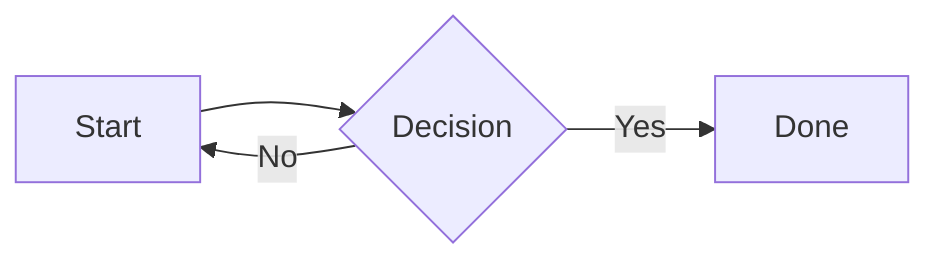

# Usage

## Layout and navigation

On a desktop screen there is a top bar (logo, search field, sync status dot, scan camera when scanning is on, lock, theme toggle) and a sidebar on the left. The sidebar has icon links to Home, All pages, Recent edits, Search, Quick notes, Files, Secrets, Link graph, Skills and Scan a photo, the **New page** and **New skill** buttons, your Favorites, Recently edited pages, and a collapsible **Documentation** group. The current page is highlighted. Page tabs (Page, Edit, Share, History) are a segmented control above the content.

### Phones

On screens up to 768px wide:

- The sidebar is a drawer. Open it with the menu button; close it with Escape or by tapping outside it. It also has a Dark/Light mode switch.
- A bottom tab bar has **Home**, **Pages**, a round centre button, **Notes** and **More** (opens the drawer). The centre button is **Scan** when scanning is enabled, otherwise **New page**.
- Content uses the full screen width and dialogs open as bottom sheets.

### Theme

The theme follows the system light/dark setting until you pick one with the toggle. The choice is remembered in the browser (`localStorage`). It also applies to public share pages and upload-link pages.

### Install as an app

Gypsum has a web app manifest (`/static/manifest.json`) and icons, so the browser can install it ("Add to Home Screen" on a phone). It opens standalone, without browser bars, at `/wiki/Home`.

## Pages

All pages live in `data/repo/pages/` as `.md` files. Click **New page** in the sidebar (on a phone: the menu) to create a page.

Use `[[Page Title]]` to link between pages. The title is converted to a slug (`Page_Title`) automatically. Clicking a link to a non-existent page opens the editor pre-populated with a heading.

If a page starts with a level-1 heading (`# My Title`), that heading is used as the browser and page title instead of the slug-derived name.

Each page has **Page**, **Edit**, **Share**, and **History** tabs.

## Secure Fields

Store sensitive values inline in your markdown:

```
WiFi password: {{secure:my-secret-password}}
```

For multiline secrets, place `{{secure:` and `}}` on their own lines:

```
{{secure:
username: admin
password: s3cret
}}
```

On save, the content is encrypted with AES-256-GCM in your browser before it
reaches the server, becoming:

```
WiFi password: {{secure_aes2:BASE64_CIPHERTEXT}}
```

The key is derived from your passphrase with PBKDF2-HMAC-SHA256 and the
per-deployment salt (`GYPSUM_SECURE_SALT`). Older `{{secure_aes:...}}` blocks
(unsalted SHA-256) still decrypt with the same passphrase; editing a page
upgrades its blocks to `secure_aes2`. See
[Configuration → Encryption](configuration.md#encryption) for the salt and bulk
migration.

The passphrase is entered once via the lock icon in the top bar and can be
remembered on the device (the derived keys are stored in `localStorage`). The
server never sees the passphrase, the derived key, or any plaintext.

When viewing the page, encrypted fields appear as `🔒****`. Click to decrypt
in the browser and reveal for 60 seconds, then it auto-hides. A clipboard
copy button appears next to revealed values.

The editor validates custom tags on save — unknown tags, unclosed blocks, and improperly formatted multiline blocks are rejected with clear error messages.

### Escaping

Prefix any macro or wiki link with a backslash to display it literally without processing:

| Input | Rendered as |
|---|---|
| `\{{secure:example}}` | `{{secure:example}}` (not encrypted) |
| `\{{secure_aes:BASE64}}` | `{{secure_aes:BASE64}}` (not expanded) |
| `\{{secure_aes2:BASE64}}` | `{{secure_aes2:BASE64}}` (not expanded) |
| `\[[Page Title]]` | `[[Page Title]]` (not a link) |

Content inside backtick code spans (`` `[[like this]]` ``) and fenced code blocks is always displayed verbatim — macros and wiki links inside them are never processed.

## Diagrams

Fence a code block with `mermaid` to render it as a diagram instead of highlighted code:

````

````

All Mermaid diagram types work (flowchart, sequenceDiagram, classDiagram, stateDiagram-v2, erDiagram, gantt, and more) — see [Mermaid's own docs](https://mermaid.js.org/) for syntax. Rendering happens in your browser and follows the light/dark theme toggle. A malformed diagram shows an error box in place without affecting the rest of the page. Works on wiki pages, public shared pages, and in these docs.

To show `mermaid` syntax literally instead of rendering it, wrap the example in a longer fence, as done above.

## Images

Three ways to upload images:

- **Paste** — copy an image to the clipboard and paste into the editor
- **Drag-and-drop** — drag an image file onto the editor textarea
- **Image picker** — click **Images** in the editor toolbar to browse and insert existing uploads

A markdown image reference is inserted at the cursor. Filenames are derived from the original file name where available.

Click an image or a diagram on a page (including public shared pages and these docs) to show it full screen; click again or press Escape to close it. An image that is also a link opens the link instead.

### Size Hints

Images automatically scale to fit the content area. Add an optional size hint to the alt text:

| Syntax | Effect |
|---|---|
| `` | max-width: 500px |
| `` | max-width: 50% |
| `` | width: 800px, height: 400px |

### Image Management

Manage images and documents at `/images` (linked as **Files** in the sidebar). The index shows each image's thumbnail, filename, file size, and which pages reference it. Unused images can be deleted. A **Documents** table below lists uploaded files with a delete button.

Supported image formats: PNG, JPG, JPEG, GIF, WEBP, SVG. HEIC is rejected; convert it to JPEG first. The size limit is `GYPSUM_UPLOAD_MAX_MB` (default 20).

JPEG uploads are always re-encoded: the EXIF orientation is applied and EXIF data, including GPS location, is dropped. JPEG and PNG are scaled so the longest side is at most `GYPSUM_IMAGE_MAX_PX` (default 2048; `0` stores them unchanged). Other formats are stored as uploaded.

## Files and photos

Besides images, you can upload PDF, TXT, MD, CSV, JSON, DOCX, XLSX, PPTX, ODT, ODS and ODP files. They are stored in `files/` in the git repo and committed as `wiki: upload file <name>`. The content must match the extension. Names get a date and random suffix, e.g. `report-20261012-1a2b3c4d.pdf`.

In the editor, drag and drop a non-image file onto the textarea. It is uploaded and a `[name](/files/...)` link is inserted.

`/files/<name>` serves PDFs inline, txt/md/csv/json as plain text, and Office files as a download.

**Search.** The text layer of PDFs (no OCR; scanned pages give nothing) and the text of txt/md/csv/json files is indexed. Web search shows matches in a **Files** section; the `list_files` MCP tool searches them too. The index is rebuilt at startup and after a git pull, and a file is re-read only when its size or modification time changes.

### Upload links

An image attached in a Claude chat cannot be passed to an MCP tool. Ask Claude for an upload link (`create_upload_link`, see [MCP Server](mcp.md#uploading-files)). The page is made for phones: a file input with camera and an optional caption. A link works once and for 30 minutes.

Behind Authelia or another proxy, an upload link works as long as the browser that opens it is logged in. To skip that login, bypass `/upload/*`; see [Authentication](authentication.md).

## Photo scans

With `ANTHROPIC_API_KEY` set (see [Configuration](configuration.md)), a camera button appears (in the top bar on a desktop, as the round centre button of the bottom bar on a phone) and each page gets an **Add scan** tab. Both open `/scan`. Use **Take photo** to open the phone camera, or **Choose photo** to pick a file, and add an optional note for Claude. JPEG, PNG and WebP work; HEIC is rejected. The size limit is `GYPSUM_UPLOAD_MAX_MB`.

**The photo is sent to Anthropic.** Do not scan anything you cannot send there. Each scan is one Claude API call billed to your key (about 5k image tokens plus the output).

The photo is turned upright and scaled down (long edge at most 2576 px) before it is sent. First a small, fast model (`GYPSUM_SCAN_CORNER_MODEL`, Claude Haiku by default) looks for a document in the photo — a page, receipt, letter, screen or whiteboard — and gives its four corners in reading order. It also traces the outline of the part of the page that is in the photo; when the page runs off the edge of the photo (common at a low angle), the hidden corners are found by extending the page's edges. If it finds a page, the page is cut out of the full-resolution photo and its perspective corrected, so a page photographed at an angle on a table comes out flat, upright and in its real proportions, without the table. Parts of the page outside the photo come out white. Photos of things that are not documents, and pages that already fill the photo, are left as they are. While the page is read, the progress screen shows the photo with the found outline drawn on it; if the outline is wrong, tap **Use the photo as it is** to stop and scan the photo again without straightening. The preview screen shows the outline too, with the same button. Claude transcribes the text as Markdown and uses what the wiki can show: grids (tables, schedules, pin charts) become Markdown tables, and flows (steps with arrows, decision trees) become Mermaid diagrams. Drawings whose layout matters, such as schematics, stay pictures. Claude also gets the titles of existing pages (up to 1500, most recently edited first) and links the first mention of each as `[[Title]]`; links to pages that do not exist are removed before saving. It also marks the figures. Each figure is cropped from the full-resolution photo, stored as an image and embedded where it sat in the original. Claude picks a style per figure (for a photo that is not a document, the whole photo is one figure), and the image is processed to match. For the first three styles, uneven light on paper or a whiteboard is evened out first, so the paper comes out white even in shadow: **bw** (line art, reduced to pure black and white), **gray** (shaded drawings, reduced to 4 gray levels), **palette** (flat-color drawings, icons, charts and pixel art, posterized to the 2-8 colors Claude names) or **photo** (kept as a full-color JPEG). The first three are stored as small PNGs.

A photo that is not a document (a car, a bird, a person, a building) is put on the page itself, cropped to its subject and scaled down to `GYPSUM_IMAGE_MAX_PX`, with a description under it.

- **From the camera button:** a new page is created. Claude picks the title (` 2`, ` 3` is added if the title exists). The page is not linked from anywhere yet: the result screen lists the pages that best match its title and topic (full-text search, blended with semantic search when it is on) plus Home. Tap one to add a link to the new page there, type another page name, or leave it unlinked; it is still listed in All pages and search.
- **From the Add scan tab** (`/scan?page=Slug`): Claude gets the page's content and either appends the new part (for example the next page of a manual) or rewrites the whole page so every item has the same layout (for example a heading per picture, or a table with a picture and a description column). A rewrite keeps every existing image and file link; one that Claude drops is added back at the end. The old version stays in the page history. Pages longer than 20,000 characters or with encrypted fields are never rewritten; Claude only gets their headings and the scan is appended. Several scans of the same page can wait for review at once; each one is added to the page as it is when you save it. A rewrite is not saved if the page was edited after the photo was read; scan again.

**Nothing is saved until you check it.** The scan runs in the background; `/scan/{id}` shows progress, then a preview: the new page, the part to be added, or the rewritten page, with the cut-out pictures. **Save page** stores the pictures and the page and commits them. **Discard and scan again** drops the scan and goes back to the capture screen, so a retake leaves nothing in the git history. After saving, the screen links to the page and offers **Scan another photo into this page**. The original photo is not kept. Jobs, including previews that were not saved, are kept in memory for 1 hour, so a restart loses them.

## Page History

Click the **History** tab to view the git commit log for a page. Select two revisions using the **Old** and **New** radio buttons, then click **Compare Selected** to see a colorized unified diff. The author column shows who made each change: the signed-in user for web edits, or the MCP client (for example `claude-code (MCP)`) for agent edits; see [MCP Server](mcp.md#commit-authors).

To undo edits, click **Restore** on an older revision (the newest row is marked **Current**), or **Restore older version** below a comparison to go back to the older side. After a confirmation the page text is replaced by that revision and saved as a new revision named `wiki: restore page <slug> to <hash>`. Nothing is removed from the history, so a restore can be undone the same way. Restoring works for pages; skills are not covered yet.

## Git Sync Status

When a git remote is configured (`GYPSUM_GIT_REMOTE_URL`), a status dot appears
in the top bar next to the lock icon:

- **Green** — the last fetch/push to the remote succeeded.
- **Amber (pulsing)** — a fetch or push is in progress.
- **Red** — the last fetch or push failed (e.g. the remote is unreachable or
  credentials are wrong).

Hover over the dot to see the details: how long ago it last synced when healthy,
or the (credential-sanitized) error message when failing, so you know changes
may not have reached the remote.

The indicator is hidden entirely when no remote is configured. It refreshes
every 15 seconds by polling the `GET /git-status` endpoint, which returns the
current sync health as JSON.

## Diff Preview

Tick "Show diff" in the editor before saving to see a colorized unified diff of changes. The diff shows raw on-disk content including encrypted tags. The preference is remembered across sessions. Click **Confirm Save** to commit or **Back to Editor** to continue editing.

## Favorites

Edit the special `_favorites.md` page (the pencil icon next to the Favorites heading in the sidebar) to pin pages:

```
[[Home]]
[[Scratch Pad]]
[[My Important Page]]
```

## Search

Use the search bar or visit `/search`. Queries are split into individual terms, each matched independently against page titles and content. Prefix matching is supported — e.g. "lösen" finds "lösenord". Title matches score higher than content matches, and pages matching all terms are boosted.

With [semantic search](configuration.md#semantic-search) enabled, pages that match by meaning are mixed into the results, so "backing up my notes" also finds a page titled "Backup Strategy". Those results show a plain excerpt from the best-matching part of the page and no highlighted terms.

## Table Editor

Click **Insert Table** (or **Edit Table** when the cursor is inside a table) to open a visual table editor. Supports adding/removing rows and columns and per-column alignment (left/center/right).

## Link Graph

Visit `/graph` for an interactive force-directed graph showing how pages connect via `[[wiki links]]`. Double-click a node to navigate to that page.

## MediaWiki Import

Click "Import MediaWiki" in the editor to paste MediaWiki wikitext and convert it to Markdown. Handles headings, bold/italic, `<syntaxhighlight>`, `<nowiki>`, lists, tables, wiki links, and preformatted lines.

## Public Page Sharing

Share any page or [skill](skills.md) via the **Share** tab. Public pages are rendered in a minimal read-only layout without sidebars, editing, or navigation. Wiki links become plain text and encrypted fields are hidden. Links can be revoked or regenerated at any time.

Uploaded images shown on the page load through the link, as `/public/<token>/<image>`, so viewers do not need to log in. Only images the page actually shows are served this way; other images under `/images/` still need a login.

The page has [Open Graph](https://ogp.me/) tags, so chat apps such as Discord show a preview with the title, the first 200 characters of text and the first image (SVG images are skipped). The app fetches the link and may keep the preview for a while after you revoke it.

## Printing

Use your browser's print function (Ctrl+P / Cmd+P) to get a clean printout with just the page title and content. Navigation (top bar, sidebar, bottom bar), tabs, and encrypted fields are hidden automatically.
